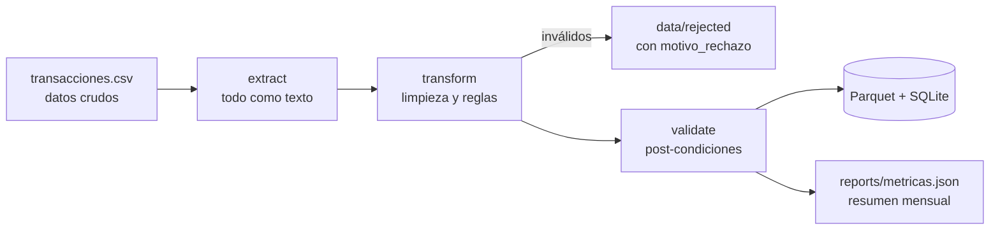

# 1. Pipeline de transacciones bancarias

## Problema de negocio
Las transacciones llegan desde distintos canales con formatos inconsistentes. Si no se limpian, los reportes de gasto, los modelos de comportamiento y el monitoreo transaccional trabajan con duplicados, montos erróneos y fechas imposibles.

## Flujo



## Problemas inyectados y cómo se resuelven

| Problema en el dato crudo | Tratamiento |
|---|---|
| Transacciones duplicadas (3 %) | Se conserva la primera por `id_transaccion`; el resto va a rechazados |
| Fechas en `YYYY-MM-DD HH:MM:SS` y `DD/MM/YYYY`, más fechas imposibles (`31/02/2025`, `N/A`) | Parseo con ambos formatos; las inválidas se rechazan |
| Montos con separador de miles (`1.250.000`) | Normalización a número |
| Créditos con monto negativo | El sentido lo define `tipo`; el monto se corrige a positivo y se cuenta |
| Montos en cero y monedas inválidas (`XXX`) | Rechazo con motivo |
| Categorías inconsistentes (`" supermercado "`, `SUPER`, nulas) | Mayúsculas, sin acentos, sinónimos; lo no reconocido pasa a `SIN_CATEGORIA` |
| Moneda USD | Conversión a PYG con tipo de cambio fijo de ejemplo (`monto_pyg`) |

## Resultados (ejecución con semilla 42)

| Métrica | Valor |
|---|---|
| Filas de entrada | 5.150 |
| Filas limpias | 4.896 |
| Rechazadas | 254 (150 duplicados, 60 fechas inválidas, 24 montos inválidos, 20 monedas inválidas) |
| Duplicados | 2,91 % |
| Signos de monto corregidos | 13 |
| Sin categoría | 146 |

Salidas: `data/processed/transacciones.parquet`, `data/processed/banco.db` (tabla `transacciones`), `reports/resumen_mensual_categoria.csv`.

## Ejecutar

```bash
python scripts/generate_data.py
python -m etl_transacciones.pipeline
pytest -q tests
```

Consulta de ejemplo sobre SQLite:

```sql
SELECT anio_mes, categoria, COUNT(*) AS n, SUM(monto_con_signo) AS neto_pyg
FROM transacciones GROUP BY 1, 2 ORDER BY 1, 3 DESC;
```

## Próximos pasos
Cargar a PostgreSQL con SQLAlchemy, validar esquemas con `pandera`, programar con Prefect/Airflow y tomar el tipo de cambio diario de una API.
