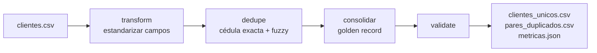

# 2. Limpieza y deduplicación de clientes (KYC)

## Problema de negocio
Un mismo cliente aparece cargado varias veces (distintas sucursales, errores de tipeo, datos incompletos). Eso rompe la visión única del cliente, duplica campañas, distorsiona el riesgo por deudor y complica el cumplimiento KYC/AML.

## Flujo



## Estandarización

| Campo | Regla |
|---|---|
| Nombre | `GONZÁLEZ BENÍTEZ, José` → `JOSE GONZALEZ BENITEZ` (reordena formato "apellido, nombre", mayúsculas, sin acentos ni signos) |
| Cédula | Solo dígitos, 5 a 8; descarta basura (`0`, `1111111`) |
| RUC | Formato `número-DV` y verificación del **dígito verificador (módulo 11)**; si la cédula falta y el RUC es válido, se recupera desde el RUC |
| Teléfono | Celulares a `+595 9XX XXXXXX`; incompletos → nulo |
| Email | Minúsculas y validación de formato |
| Ciudad / dirección | Diccionario de variantes (`Fdo. de la Mora`, `CDE`) y abreviaturas (`Avda.`, `C/`) |

## Detección de duplicados

1. **Regla exacta:** misma cédula normalizada.
2. **Regla difusa:** nombre normalizado con `rapidfuzz.WRatio ≥ 92`, **solo dentro del mismo bloque de fecha de nacimiento** (blocking: evita comparar todos contra todos).
3. Los pares se agrupan con **Union-Find** en clústeres y se elige el *golden record* por completitud y antigüedad.

**Decisión técnica:** se probó `token_sort_ratio`, pero falla cuando el error de tipeo cambia la inicial de un nombre (el orden alfabético desalinea los tokens). `WRatio` con umbral 92 separó bien los casos positivos (95–96) de homónimos con apellido distinto (≤ 89).

## Resultados (semilla 11)

920 registros = 800 clientes reales + 120 duplicados inyectados.

| Métrica | Valor |
|---|---|
| Clientes únicos tras consolidar | 805 |
| Pares detectados | 115 (99 por cédula, 16 por nombre difuso) |
| **Precisión** | **100 %** |
| **Recall** | **95,8 %** |
| RUC con dígito verificador incorrecto | 25 de 481 |
| Cédulas recuperadas desde el RUC | 47 |
| Teléfonos / emails inválidos o vacíos | 22 / 270 |

**Limitación conocida:** los duplicados perdidos son los que no tienen cédula ni fecha de nacimiento, por lo que no caen en ningún bloque. Se mejoraría con un segundo bloqueo (por apellido + teléfono).

Como los datos son sintéticos, `clientes_ground_truth.csv` permite medir precisión y recall reales.

## Ejecutar

```bash
python scripts/generate_data.py
python -m etl_kyc.pipeline
pytest -q tests
```
