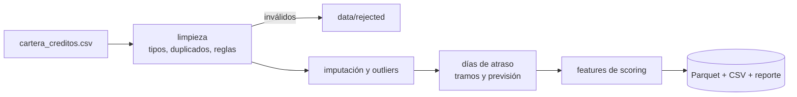

# 3. Cartera de créditos y mora

## Problema de negocio
Para medir la calidad de la cartera y alimentar modelos de scoring se necesita un dataset confiable: con ingresos completos, sin outliers que distorsionen, y con la mora medida de forma consistente (días de atraso y tramos).

## Flujo



## Reglas aplicadas

| Tema | Tratamiento |
|---|---|
| Duplicados por `id_credito` | Rechazo con motivo |
| Saldo negativo | Rechazo (`saldo_invalido`) |
| Fecha de impago anterior al desembolso | Rechazo (`impago_anterior_a_desembolso`) |
| Tasas como texto (`18,5%`) | Conversión a número |
| Producto con formatos distintos | Mayúsculas y trim |
| Edades imposibles (0, 7, 150, 999) | A nulo e imputación por mediana, con bandera `edad_imputada` |
| Ingresos atípicos | Winsorización por producto con IQR × 3, bandera `ingreso_outlier` |
| Ingresos nulos | Mediana por producto, bandera `ingreso_imputado` |

Las banderas mantienen la trazabilidad: un modelo posterior puede decidir si confía o no en un dato imputado.

## Mora y variables derivadas

- `dias_atraso` = fecha de corte − primera cuota impaga (0 si está al día).
- `tramo_mora`: `0_AL_DIA`, `1_30`, `31_60`, `61_90`, `91_180`, `MAS_180`.
- `en_mora_90`: marca para índice de morosidad y variable objetivo de scoring.
- `prevision_monto`: porcentajes **ilustrativos** por tramo (no son la normativa del BCP).
- Features: `cuota_estimada` (sistema francés), `ratio_cuota_ingreso`, `antiguedad_credito_meses`, `pct_capital_pendiente`.

## Resultados (corte 30/06/2025, semilla 2025)

| Métrica | Valor |
|---|---|
| Filas de entrada → créditos limpios | 3.030 → 2.971 |
| Rechazados | 59 (30 duplicados, 15 saldos inválidos, 14 fechas incoherentes) |
| Ingresos imputados / outliers ajustados | 238 / 42 |
| Edades corregidas | 74 |
| Saldo total de cartera | Gs. 257.048.733.000 |
| **Índice de morosidad (>90 días)** | **4,0 %** |
| Previsión total (ilustrativa) | Gs. 11.699.527.830 |

| Tramo | Créditos |
|---|---|
| 0_AL_DIA | 2.452 |
| 1_30 | 216 |
| 31_60 | 113 |
| 61_90 | 74 |
| 91_180 | 74 |
| MAS_180 | 42 |

Salidas: `data/processed/cartera_limpia.parquet`, `data/processed/features_scoring.csv`, `reports/resumen_producto_tramo.csv`.

## Ejecutar

```bash
python scripts/generate_data.py
python -m etl_mora.pipeline
pytest -q tests
```

## Próximos pasos
Entrenar un modelo de scoring (regresión logística / gradient boosting) sobre `features_scoring.csv` usando `en_mora_90` como objetivo, y analizar matrices de transición entre tramos mes a mes.
