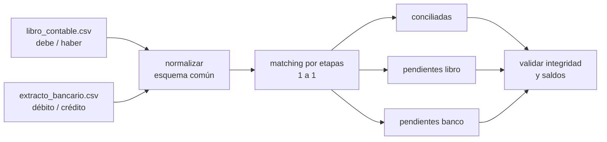

# 4. Conciliación bancaria

## Problema de negocio
Cada mes, tesorería y contabilidad deben cruzar el extracto del banco contra el libro contable de la cuenta y explicar cada diferencia: cheques y depósitos en tránsito, comisiones o intereses aún no registrados, errores de monto. Hacerlo a mano en Excel es lento y propenso a errores.

## Flujo



**Convención de signo:** ingreso a la cuenta = positivo, egreso = negativo. Libro: `debe − haber`. Banco: `crédito − débito`.

## Motor de conciliación

Cada etapa trabaja solo con lo que las anteriores no resolvieron, de la regla más estricta a la más flexible:

| Etapa | Criterio | Tolerancia |
|---|---|---|
| 1 | Referencia + monto + fecha | exacta |
| 2 | Referencia + monto | hasta 3 días (desfase de acreditación) |
| 3 | Monto + fecha, sin referencia | hasta 3 días |
| 4 | Referencia | monto hasta Gs. 50.000 de diferencia (comisión retenida) |

Las referencias se normalizan antes de cruzar (`TRX-000123` = `trx000123`). El cruce es 1 a 1, priorizando el menor desfase.

Los pendientes se clasifican por causa probable: `DEPOSITO_EN_TRANSITO`, `CHEQUE_O_PAGO_EN_TRANSITO`, `COMISION_BANCARIA_NO_REGISTRADA`, `INTERES_NO_REGISTRADO`, `DEBITO_AUTOMATICO_NO_REGISTRADO`.

## Control de integridad

El pipeline falla si no se cumple la identidad contable:

```
saldo_banco − saldo_libro = partidas solo banco − partidas solo libro + diferencias de monto en conciliadas
```

También verifica que ningún movimiento se concilie dos veces y que `conciliadas + pendientes = total` en ambas fuentes.

## Resultados (semilla 7, junio 2025)

| Métrica | Valor |
|---|---|
| Movimientos libro / banco | 1.200 / 1.203 |
| Conciliados | 1.158 (96,5 % del libro) |
| Por etapa | 1.008 · 71 · 57 · 22 |
| Pendientes libro | 42 (24 depósitos en tránsito, 18 cheques/pagos en tránsito) |
| Pendientes banco | 45 (31 comisiones, 7 débitos automáticos, 7 intereses) |
| Saldo según banco | Gs. 3.403.581.500 |
| Saldo según libro | Gs. 3.495.298.000 |
| Diferencia de saldos | Gs. -91.716.500 |
| **Diferencia no explicada** | **0** |

Salidas: `data/processed/conciliadas.csv`, `pendientes_libro.csv`, `pendientes_banco.csv`, `reports/metricas.json`.

## Ejecutar

```bash
python scripts/generate_data.py
python -m etl_conciliacion.pipeline
pytest -q tests
```

## Próximos pasos
Conciliación 1 a N (un depósito que agrupa varias facturas), matching difuso por descripción y generación del formulario de conciliación en Excel.
